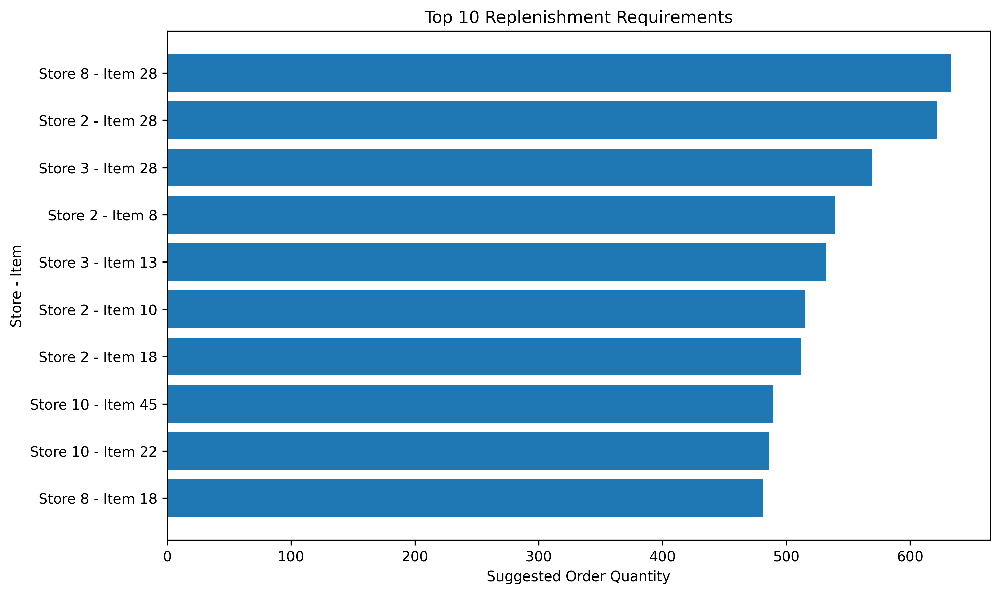
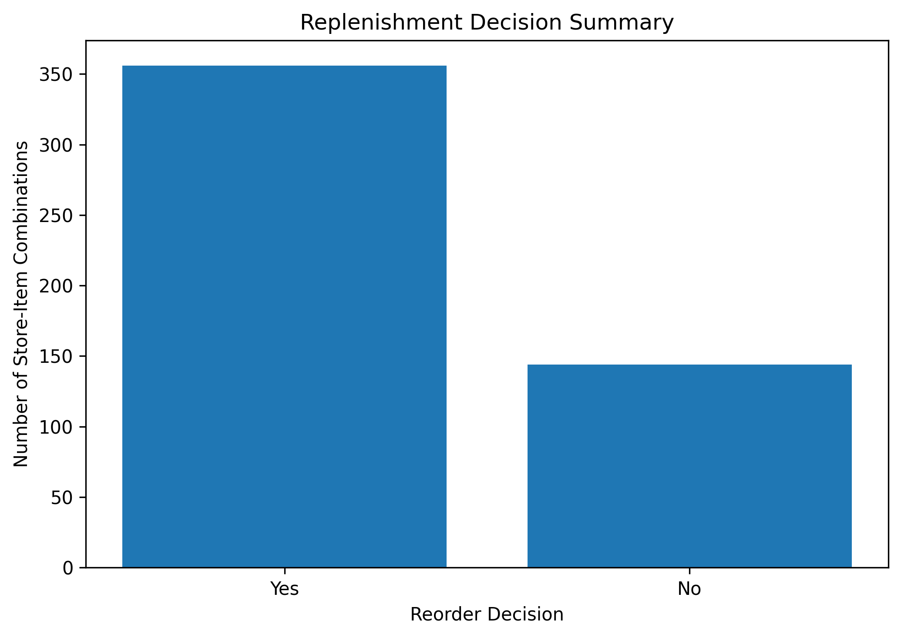

# Retail Demand Forecasting & Inventory Planning

Forecasting daily retail sales and translating predictions into an illustrative inventory replenishment framework using Python, statistical modelling, and inventory planning concepts.

---

## Project Overview

This project develops an end-to-end retail demand forecasting workflow and demonstrates how sales forecasts can be translated into practical inventory replenishment decisions.

The analysis uses historical daily sales data across multiple stores and items to:

1. Understand historical demand patterns
2. Build and evaluate a forecasting model
3. Generate future daily sales forecasts
4. Estimate demand during supplier lead time
5. Calculate safety stock and reorder points
6. Identify store-item combinations requiring replenishment
7. Estimate suggested replenishment quantities

The project therefore moves beyond prediction alone and demonstrates how forecasting can support operational decision-making.

---

## Business Objective

Retail businesses need to anticipate future demand while maintaining sufficient stock to meet customer needs without unnecessarily overstocking inventory.

This project addresses two related business questions:

1. **How much demand is expected in the future?**
2. **How can those forecasts be translated into inventory replenishment decisions?**

The forecasting component estimates future daily sales for each store-item combination.

The inventory planning component then uses those forecasts together with demand variability and simulated inventory positions to calculate:

- Lead-time demand
- Safety stock
- Reorder points
- Reorder decisions
- Suggested order quantities

---

## Dataset

The project uses a retail sales dataset containing historical daily sales across multiple stores and products.

### Historical data

- Period: January 2013 to December 2017
- Approximately 913,000 daily sales records
- 10 stores
- 50 items
- 500 unique store-item combinations

Each historical row represents the number of units sold for one item at one store on one day.

Core fields:

- `date`
- `store`
- `item`
- `sales`

### Forecast data

The supplied test dataset covers:

- January to March 2018
- 90-day forecast horizon
- 45,000 store-item-date observations

The test dataset does not contain actual sales values.

Therefore, final 2018 forecast accuracy cannot be directly measured.

---

## Project Workflow

The analysis followed the workflow below:

1. Data quality checks
2. Exploratory analysis
3. Time-based feature engineering
4. Training-validation split
5. Seasonal naïve baseline
6. Poisson regression model
7. Model evaluation
8. Final model retraining
9. 90-day demand forecasting
10. 7-day lead-time demand estimation
11. Historical demand variability calculation
12. Safety stock calculation
13. Simulated current inventory creation
14. Reorder point calculation
15. Reorder decision
16. Suggested replenishment quantity
17. Management-facing replenishment analysis

---

## 1. Data Quality Checks

The dataset was checked for:

- Missing values
- Duplicate records
- Negative sales values
- Date coverage
- Store coverage
- Item coverage
- Store-item combinations

These checks ensured that the dataset was suitable for time-based forecasting analysis.

---

## 2. Exploratory Data Analysis

Historical sales were examined to understand:

- Overall sales trends
- Seasonal patterns
- Variation across time
- Differences between stores and items

The historical data showed clear recurring seasonal behaviour, making a seasonal forecasting benchmark appropriate.

---

## 3. Feature Engineering

The forecasting model used both categorical and time-based predictors.

Features included:

- Store
- Item
- Month
- Day of week
- Time index

The time index represents the progression of time from the beginning of the historical dataset.

Categorical variables were one-hot encoded.

The time index was standardized.

These transformations were implemented within a scikit-learn pipeline to ensure that preprocessing and modelling were handled consistently.

---

## 4. Training and Validation Strategy

The model was not evaluated using the same observations on which it was trained.

Historical data from:

**2013–2016**

was used for model training.

A future period:

**January–March 2017**

was held out for validation.

This created a realistic forecasting scenario in which the model predicted a future period that had not been used during training.

---

## 5. Seasonal Naïve Baseline

A seasonal naïve model was created as a benchmark.

The baseline forecast used sales from approximately 52 weeks earlier as the prediction for the corresponding future date.

This provided a simple reference model against which the more advanced forecasting approach could be evaluated.

### Baseline performance

Validation Mean Absolute Error:

**7.52 units per store-item-day**

---

## 6. Poisson Regression Forecasting Model

A Poisson regression model was used as the main forecasting model.

Poisson regression is appropriate for this project because the target variable represents non-negative sales counts.

The model used:

- Store
- Item
- Month
- Day of week
- Time index

Preprocessing and modelling were combined using a scikit-learn pipeline.

---

## 7. Model Evaluation

Forecast performance was assessed using:

### Mean Absolute Error (MAE)

MAE measures the average absolute difference between forecast sales and actual sales.

Lower MAE indicates better predictive performance.

The Poisson regression model reduced validation MAE by approximately:

**22.5% relative to the seasonal naïve baseline**

This represents a reduction in forecast error, not a 22.5% accuracy score.

### Forecast Bias

Forecast bias was also examined to determine whether predictions were systematically above or below actual sales.

The model broadly followed the rises and falls in aggregate demand but showed a tendency to overpredict during the validation period.

This limitation was retained and documented rather than ignored.

---

## 8. Final Model Training

After model performance had been evaluated using the validation period, the forecasting pipeline was retrained using the complete historical training dataset from:

**January 2013 to December 2017**

The validation period was included at this stage because model evaluation had already been completed.

Retraining on all historical observations allowed the final model to use the maximum amount of available historical information before forecasting 2018 demand.

---

## 9. Final Demand Forecast

The retrained model generated predictions for every row of the test dataset.

Final forecast period:

**January–March 2018**

Number of predictions:

**45,000**

No missing predictions were produced.

The resulting daily forecasts form the basis of the inventory planning stage.

---

# Inventory Planning

The forecasting analysis was extended into an illustrative inventory replenishment framework.

The objective was to demonstrate how predicted demand could support decisions such as:

- When inventory should be reordered
- How much safety stock should be maintained
- Which store-item combinations require attention
- How many units could be replenished

---

## 10. Supplier Lead-Time Demand

A supplier lead time of:

**7 days**

was assumed.

The model forecasts for the first seven days of January 2018 were aggregated for every store-item combination.

This produced:

**7-day forecast demand**

which represents the expected number of units that could be sold while waiting for a replenishment order to arrive.

---

## 11. Historical Demand Variability

Daily sales are not constant.

To account for demand uncertainty, the historical standard deviation of daily sales was calculated separately for every store-item combination.

This metric captures how much daily sales normally vary around their historical average.

Higher variability implies greater uncertainty and therefore generally requires more safety stock.

---

## 12. Safety Stock

Safety stock was calculated using a standard demand-variability approach:

Safety Stock = Z × Daily Demand Standard Deviation × √Lead Time

Where:

- `Z` = service-level Z-score
- Daily Demand Standard Deviation = historical daily sales variability
- Lead Time = 7 days

A service level of:

**95%**

was assumed.

The corresponding one-sided Z-score used was:

**1.645**

Therefore:

Safety Stock = 1.645 × Daily Sales Standard Deviation × √7

This formulation assumes:

- Supplier lead time is fixed
- Demand variability is the primary source of uncertainty

More advanced inventory systems could additionally model supplier lead-time variability.

---

## 13. Current Inventory Simulation

The source dataset contains sales data but does not include actual inventory-on-hand balances.

Therefore, real current inventory positions cannot be calculated from the dataset.

To demonstrate the replenishment framework, a simulated current inventory position was created for every store-item combination.

The simulation was generated using a fixed random seed to ensure reproducibility.

These inventory values are illustrative and should not be interpreted as actual business stock levels.

---

## 14. Reorder Point

The reorder point represents the inventory level at which a replenishment order should be triggered.

It was calculated as:

Reorder Point = Forecast Lead-Time Demand + Safety Stock

This combines:

- Expected demand while waiting for stock to arrive
- Additional protection against demand uncertainty

---

## 15. Reorder Decision

A reorder was triggered whenever:

Current Inventory < Reorder Point

If current inventory remained above the reorder point, no replenishment was triggered.

This produced a clear:

- `Yes`
- `No`

replenishment decision for every store-item combination.

---

## 16. Suggested Order Quantity

For combinations requiring replenishment, suggested order quantity was calculated as:

Suggested Order Quantity = Reorder Point − Current Inventory

If current inventory exceeded the reorder point:

Suggested Order Quantity = 0

Inventory planning quantities were rounded upward to whole units using the ceiling function.

Rounding upward prevents the calculated replenishment quantity from falling slightly below the required threshold.

---

# Inventory Planning Results

The simulated inventory scenario evaluated:

**500 store-item combinations**

Results:

- **356** combinations required replenishment
- **144** combinations remained above their reorder point
- **71.2%** simulated reorder rate
- **70,748 units** total suggested replenishment
- **198.7 units** average suggested order quantity among triggered reorders
- **633 units** largest individual suggested order

The largest simulated replenishment requirement occurred for:

**Store 8 – Item 28**

with:

- Current inventory: 105 units
- 7-day forecast demand: approximately 614 units
- Safety stock: 124 units
- Reorder point: 738 units
- Suggested replenishment quantity: 633 units

Because current inventory values were simulated, these results demonstrate the inventory decision framework rather than actual operational stock requirements.

---

## Management-Facing Output

A management-facing replenishment table was created containing only store-item combinations requiring action.

The table was ranked by suggested order quantity so that the largest inventory shortfalls could be identified immediately.

The final output includes:

- Store
- Item
- Current inventory
- 7-day forecast demand
- Safety stock
- Reorder point
- Reorder decision
- Suggested order quantity

This demonstrates how analytical outputs can be transformed into an operational decision-support tool.

---

## Visualizations

### Top 10 Replenishment Requirements



### Replenishment Decision Summary



The project includes visual analysis for both forecasting and inventory planning.

Key visualizations include:

- Historical sales patterns
- Actual versus predicted sales
- Forecast behaviour during validation
- Top 10 replenishment requirements
- Reorder versus no-reorder summary

The replenishment visualizations help identify which store-item combinations require the largest simulated inventory interventions.

---

# Key Findings

### Forecasting

- Retail sales display recurring seasonal behaviour.
- The seasonal naïve model provided a useful forecasting benchmark.
- Poisson regression reduced validation MAE by approximately 22.5% relative to the seasonal baseline.
- The regression model captured the general movement of aggregate demand.
- Some systematic overprediction remained during validation.

### Inventory Planning

- Forecasting outputs can be converted directly into lead-time demand estimates.
- Historical demand variability can be used to estimate safety stock.
- Reorder points provide a clear inventory replenishment trigger.
- Forecasting becomes more operationally useful when connected to inventory decisions.
- Store-item prioritization can help managers focus on the largest potential stock shortfalls.

---

# Business Value

The project demonstrates the difference between prediction and decision support.

The forecasting model answers:

**How much demand is expected?**

The inventory planning layer answers:

**Given expected demand and available stock, what action should be taken?**

Combining both creates a more complete analytics workflow.

Instead of stopping at model predictions, the project converts forecasting results into:

- Inventory thresholds
- Replenishment triggers
- Safety stock requirements
- Suggested replenishment quantities
- Management priorities

This illustrates how predictive analytics can support real operational business decisions.

---

# Limitations

Several limitations should be considered when interpreting the results.

### Forecasting limitations

- Model evaluation uses one 90-day validation period.
- Final January–March 2018 forecast accuracy cannot be measured because actual test sales are unavailable.
- Historical recorded sales are treated as a proxy for demand.
- Stockouts in the historical period could mean recorded sales underestimate true customer demand.
- Price information is unavailable.
- Promotions are unavailable.
- Holiday effects are not explicitly included.
- Stock availability is unavailable.

### Inventory limitations

- Actual current inventory balances are unavailable.
- Current inventory positions are therefore simulated.
- Supplier lead time is assumed to be fixed at 7 days.
- Supplier lead-time variability is not modelled.
- A common 95% service level is used across all items.
- Minimum order quantities are not included.
- Supplier capacity constraints are not included.
- Order costs are not included.
- Inventory holding costs are not included.
- Stockout costs are not included.
- Backorders and stock already on order are not available.

The simulated replenishment quantities should therefore not be interpreted as actual operational recommendations.

---

# Potential Improvements

Future extensions could incorporate:

### Forecasting improvements

- Additional validation windows
- Rolling time-series cross-validation
- Promotion data
- Price information
- Holiday indicators
- Weather or external demand drivers
- Gradient-boosting models
- Dedicated time-series models
- Store-item-specific models
- Forecast uncertainty intervals

### Inventory improvements

- Actual inventory-on-hand balances
- Inventory already on order
- Backorders
- Variable supplier lead times
- Supplier reliability
- Product-specific service levels
- Minimum order quantities
- Case-pack constraints
- Supplier capacity
- Holding costs
- Ordering costs
- Stockout costs
- Economic order quantity
- Automated replenishment recommendations

### Deployment improvements

The project could also be extended into an interactive application using:

- Power BI
- Streamlit
- Dash
- Automated scheduled forecasting pipelines

---

# Project Files

```text
retail-forecasting/
│
├── data/
│   ├── train.csv
│   ├── test.csv
│   └── sample_submission.csv
│
├── notebooks/
│   └── 01_demand_forecasting.ipynb
│
├── outputs/
│   ├── daily_sales_forecast.csv
│   ├── inventory_plan.csv
│   └── submission.csv
│
├── images/
│
├── README.md
├── requirements.txt
└── .gitignore

## Summary

This project demonstrates an end-to-end analytics workflow moving from:

**Historical Sales → Forecasting → Model Evaluation → Future Demand → Safety Stock → Reorder Point → Replenishment Decision**

The result is not only a predictive model, but an example of how data science can be translated into practical retail inventory decision support.